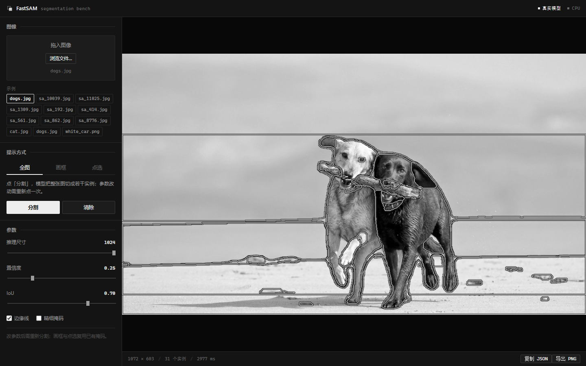

# FastSAM Bench

一个跑在本机上的 FastSAM 分割工作台：载入一张图，用全图 / 画框 / 点选 / 画笔四种方式拿到实例掩码，然后导出成掩码、标注或边界框。

前端是纯静态的 HTML/CSS/JS（黑白界面），后端是 FastAPI，推理走 [FastSAM](https://github.com/CASIA-IVA-Lab/FastSAM)，CPU 和 CUDA 都支持。



## 它能做什么

- **全图分割**：一次性切成若干实例，`imgsz` / `conf` / `iou` 可调
- **画框提示**：在图上拖框，每个框各出一个实例
- **点选提示**：正点选入、负点剔除，可逐个删除
- **修掩码**：像画笔一样涂改结果，支持调节笔刷大小、添加/擦除、逐笔撤销
- **四种导出**：二值掩码 PNG、边界框（zip / json / yolo / csv）、标注包 zip、复制 JSON
- **画布操作**：滚轮缩放（以光标为锚）、空格或中键拖动平移、双击复位

## 快速开始（Windows）

1. 装 Python 3.10 ~ 3.12，然后按 [`环境清单.md`](环境清单.md) 建虚拟环境、装依赖。
   **Python 3.13 不行**，PyTorch 装不上。
2. 下载模型权重放到仓库根目录：

   ```
   https://github.com/CASIA-IVA-Lab/FastSAM/releases
   ```

   取 `FastSAM-x.pt`（或 `FastSAM-s.pt`，改一下 `webapp/engine.py` 里的 `MODEL_FILE`）。

3. 双击 `启动工作台.bat`，浏览器会自动打开 <http://127.0.0.1:8000>。
   想生成桌面快捷方式，双击 `创建桌面快捷方式.bat`。

手动启动：

```bat
.venv\Scripts\python.exe webapp\server.py 8000
```

没装 torch 也能跑起来——会自动退到「模拟模式」，用颜色聚类假装分割，只有界面没有真结果，方便调前端。

## 目录

```
webapp/
  server.py        FastAPI 服务：上传、分割、提示、画笔、导出
  engine.py        推理层：Scene 数据契约 + RealEngine / MockEngine
  static/          前端（index.html / style.css / app.js）
  smoke_test.py    冒烟测试：13 组，含中文文件名、导出、错误处理
  check_ui.py      前端 id 引用一致性检查
fastsam/           FastSAM 模型定义（来自上游）
ultralytics/       上游 vendored 的 ultralytics 8.0.120
start.bat          一键启动：找 Python → 起服务 → 开浏览器
```

## 说明

- **模型权重不进仓库**（138 MB，超过 GitHub 单文件限制），请自行下载。
- 上传的图片会缓存在 `webapp/.cache/images/`，按 200 张 / 512 MB 自动回收，可以随时整个删掉。
- 服务默认只监听 `127.0.0.1`，没有鉴权，不要直接暴露到公网。

## 许可与致谢

本仓库的 `fastsam/`、`ultralytics/`、`utils/` 以及若干推理脚本来自
[CASIA-IVA-Lab/FastSAM](https://github.com/CASIA-IVA-Lab/FastSAM)（AGPL-3.0），
`webapp/` 是这个仓库在此之上的工作台实现。整体沿用 **AGPL-3.0**，见 [LICENSE](LICENSE)。

上游 README 保留在 [`README_UPSTREAM.md`](README_UPSTREAM.md)。
