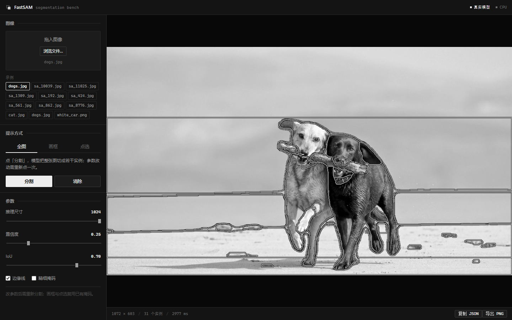

# FastSAM 检测台（本地 Web UI）

替代仓库里的 `app_gradio.py`：不用 gradio，纯 FastAPI + 原生 Canvas，浏览器打开就能用，
支持全图分割 / 画框 / 点选三种提示方式，并能导出结果图与坐标 JSON。

## 启动

### 一键启动（推荐）

文件夹根目录里有三个入口，随便挑：

| 文件 | 用途 |
| --- | --- |
| `启动工作台.bat` | 双击就行，最直觉 |
| `start.bat` | 同上，也支持参数：`start.bat 8080` 换端口 |
| `创建桌面快捷方式.bat` | 在桌面生成 `FastSAM Bench.lnk`，以后从桌面点 |

它们做的是同一件事：

1. 先探一下端口 —— 服务已经在跑就直接开浏览器，不会重复启动；
2. 没跑就在后台起一个最小化的控制台窗口，轮询到接口通了再开浏览器。

关掉那个标题为「FastSAM server」的最小化窗口，就等于停掉后端。

三个 bat 都用 `%~dp0` 定位自己所在的目录，所以**整个文件夹搬到哪都能用**，
也可以直接从别的目录调用（`D:\FastSAM_clone\start.bat`）。Python 按下面的顺序找：
`.venv\Scripts\python.exe` → `python` → `py -3.12`，都找不到会提示去看《环境清单.md》。

### 手动启动

环境已经装好在仓库里的 venv 中，**用它启动**（系统里的 `D:\python12\python.exe` 没有 torch，
用它会退回模拟模式）：

```powershell
D:\FastSAM_clone\.venv\Scripts\python.exe D:\FastSAM_clone\webapp\server.py 8000
```

然后浏览器打开 <http://127.0.0.1:8000> 。

换端口就往后面加参数，例如 `... server.py 8080`。

## 环境

**换一台机器装环境，直接看仓库根目录的《环境清单.md》**（8 节，含 CPU / CUDA 两条路线、
报错对照表、已验证组合）。这里只记本机这一份实际装了什么的快照，供对照。

`D:\FastSAM_clone\.venv`（Python 3.12，CPU 版，约 1.1 GB，不需要 GPU）：

| 包 | 版本 | 说明 |
| --- | --- | --- |
| torch | 2.5.1+cpu | 锁死版本，原因见下 |
| torchvision | 0.20.1+cpu | 必须与 torch 配套 |
| numpy / opencv-python | 2.5.4 / 5.0.0 | 掩码与渲染 |
| scipy / pandas / matplotlib / pillow / pyyaml / tqdm | — | ultralytics 与 prompt 处理 |
| fastapi / uvicorn / python-multipart | — | web 服务 |
| setuptools | 80.10.2（<81） | ultralytics 要 `pkg_resources`，81+ 已移除 |
| requests / psutil / py-cpuinfo | — | ultralytics 导入链需要 |

不用 torch / torchvision 的其它包都放在 `webapp/requirements-web.txt` 里，一条命令装完：

```powershell
.\.venv\Scripts\python.exe -m pip install -r webapp\requirements-web.txt
```

### 用 GPU 还是 CPU

**前端不关心，也不该关心**——只要后端能加载 FastSAM，界面就是同一个。
后端自己挑设备（`webapp/engine.py` 的 `pick_device()`），优先级：

1. 命令行/构造参数显式给的 device；
2. 环境变量 `FASTSAM_DEVICE`（`cuda` / `cuda:1` / `cpu`）；
3. `torch.cuda.is_available()` 为真就用 `cuda`，否则 `cpu`。

所以装了 CUDA 版 torch 的机器会自动用 GPU，什么都不用改。想知道当前跑在哪：
界面上右上角的徽章（`模拟模式` / `真实模型` + `CPU` / `CUDA`），或 `GET /api/health` 的 `device` 字段。

### 在同一台机器上重装（对照用）

```powershell
D:\python12\python.exe -m venv D:\FastSAM_clone\.venv
D:\FastSAM_clone\.venv\Scripts\python.exe -m pip install --upgrade pip "setuptools<81" wheel
D:\FastSAM_clone\.venv\Scripts\python.exe -m pip install torch==2.5.1 torchvision==0.20.1 --index-url https://download.pytorch.org/whl/cpu
D:\FastSAM_clone\.venv\Scripts\python.exe -m pip install -r D:\FastSAM_clone\webapp\requirements-web.txt
```

## 两种模式

| 模式 | 触发条件 | 掩码来源 |
| --- | --- | --- |
| 真实模式 | `import torch` 和 `import ultralytics` 都成功 | FastSAM-x.pt，CPU 推理 |
| 模拟模式 | 缺 torch 或 ultralytics | OpenCV 高斯模糊 + k-means 颜色聚类生成的伪掩码 |

页面右上角的徽章会显示当前模式；模拟模式时顶部还有一条横幅说明原因。
模拟模式的掩码没有任何语义，只用来验证界面交互，不能当作分割结果。

### 实测速度

CPU 为 i7-1165G7（4 核 8 线程），示例图 `examples/dogs.jpg`（1072×603）：

| imgsz | 首次（含预热） | 稳定 | 实例数 |
| --- | --- | --- | --- |
| 512 | 2.8 s | ≈ 0.9 s | 21 |
| 1024（默认） | 2.1 s | ≈ 2.3 s | 31 |

模型加载（`FastSAM-x.pt`，145 MB）约 0.3 s，`import torch + fastsam` 约 5 s。

> 为什么锁死 torch 2.5.1：仓库自带的 `ultralytics/yolo/utils/torch_utils.py:393`
> 调用 `torch.load(f, map_location=...)` 没传 `weights_only`，而 torch ≥ 2.6 默认
> `weights_only=True`，会解不出 checkpoint 里的自定义类。

## 用法

1. 左侧选一张示例图，或把图片拖进画布（也可以点「浏览文件…」）。上传图超过
   1600px 的长边会自动等比缩小。**载入图片只做载入，不会自动跑分割** —— 想要结果就
   自己点「分割」，或者直接切到画框 / 点选 / 修掩码。
2. **全图**：点「分割」，整图切成若干实例。改参数后要再点一次才重算。
3. **画框**：在图上按住拖动，松开即按框内 IoU 最大的实例出结果；可以画多个框，
   每个框各出一个实例（互不合并），右键撤销最后一个框。
4. **点选**：左键点目标（正样本），右键或 Shift+左键点背景（负样本）；每次点击
   自动重算。误点的提示会列在「点选」下方，点 ✕ 即可删掉（Backspace 删最后一个）。
5. **修掩码**：在图上直接涂抹来改当前这一版掩码。「添加」把涂过的地方并进实例，
   「擦除」把涂过的地方从实例里挖掉（在「添加」状态下按住右键或 Shift 也可临时擦除）。
   笔刷大小 4–140px 可调，落笔时实时预览，松手后由服务端重算。笔迹可逐笔「撤销一笔」，
   「清空修整」回到提示原始结果 —— 每次修整都从原始提示结果重算，所以撤销是干净的。
6. 「导出框」把当前这一版掩码**转成框标注**：每个实例取自己掩码的最小外接矩形，
   一次给出全套（ZIP，`masks.png` 之外的纯框版本）：

   | 文件 | 内容 |
   | --- | --- |
   | `boxes.json` | COCO 结构：`images` / `annotations`（`bbox` 为 xywh）/ `categories` |
   | `annotations_full.json` | 同样的数据，多给 `bbox_xyxy`、中心点、`area_ratio`、`fill_ratio` |
   | `labels_yolo.txt` | YOLO 训练格式 `0 cx cy w h`，全部归一化到 0~1 |
   | `boxes.csv` | 表格，Excel 能直接开 |
   | `boxes.png` | 框画在原图上的预览 |

   想要单种格式可以不打包，直接访问 `/api/boxes/{image_id}?format=json|yolo|csv` ——
   `format=yolo` 拿到的就是能直接丢给 YOLO 训练的 `labels.txt`。画笔修整过的掩码同样适用。
7. 「保存标注」把当前这一版掩码打包成 ZIP：`annotations.json`（每个实例的
   `id / bbox / area_px / area_ratio`）、`masks.png`（8 位索引掩码，0 为背景）、
   `overlay.png`、`image.png` 和一份说明文件。画笔修整过的结果同样会写进去。
8. 「复制 JSON」把当前实例的 `bbox` / `score` / `area_ratio` 复制到剪贴板
   （剪贴板不可用时自动改为下载 JSON）。「导出掩码」保存黑白二值 PNG：白 = 当前
   结果覆盖的像素，黑 = 背景，尺寸与原图一致（`0/255` 纯二值，可直接当 label 用）。

   注意二值图是「所有实例的并集」：画框/点选只命中一两个目标时是一张干净的剪影；
   全图模式下天空、沙滩也会被分出来，白占比可能到 98%，这时更适合用「保存标注」里的
   `masks.png`（每个实例一个编号）。

画布支持缩放平移：滚轮以光标为锚点缩放，按住空格或鼠标中键拖动平移，
双击或 `Esc` 复位。

画框、点选第一次用时会先替这张图跑一次全图推理（所以第一次会慢一点），之后切换提示
方式就复用缓存，不再重推。修掩码必须建立在已有结果上，没跑过会提示先分割。

载入过的图片会落一份到 `webapp/.cache/images/`（`<id>.png` 加一个记文件名的 `<id>.json`），
内存里只留最近 6 张。被挤出去的图下次访问会自动从磁盘读回来，所以 `image_id` 不会因为
连续开了很多张图、或者重启过服务而失效。只有手动清掉这个缓存目录（或换了机器）时才会
提示「图片已过期」，这时前端会自动用原来的来源（本地文件 / 示例图名）重建一次再重试。
缓存目录按 200 张、512MB 自动回收最旧的文件。

界面支持深链，可以收藏或分享某一具体示例，还可以直接落到某个提示方式
（`mode` 取 `everything / box / point / brush`）：

```
http://127.0.0.1:8000/#sample=dogs.jpg
http://127.0.0.1:8000/#sample=dogs.jpg&mode=brush
```

## 参数

- **推理尺寸 imgsz**：512–1024，越大越准越慢。CPU 上 1024 一张图大约十几秒。
- **置信度 conf**：默认 0.25。实例太多就调高。
- **IoU 阈值**：默认 0.70，控制重叠框合并的激进程度。
- **边缘线**：叠加图上是否画实例轮廓。
- **精细掩码**：对应原仓库的 `better_quality`，用更精细的掩码上采样。

## HTTP 接口

| 方法 | 路径 | 说明 |
| --- | --- | --- |
| GET | `/api/health` | `{mode, device, reason, samples}` |
| POST | `/api/upload` | multipart，字段 `file` → `{image_id, width, height, name, scaled}` |
| POST | `/api/sample` | `{name}`，name 取自 health 的 samples |
| POST | `/api/everything` | `{image_id, imgsz, conf, iou, better_quality}` |
| POST | `/api/box` | `{image_id, boxes:[[x1,y1,x2,y2]], contours, better_quality}` |
| POST | `/api/point` | `{image_id, points:[[x,y]], labels:[0|1], contours, better_quality}` |
| POST | `/api/brush` | `{image_id, strokes:[{value:1|0, radius, points:[[x,y]]}], contours}`，每次从提示原始结果重算 |
| GET | `/api/image/{image_id}` | 原图 |
| GET | `/api/result/{image_id}` | 最近一次的叠加图 PNG |
| GET | `/api/mask/{image_id}` | 黑白二值掩码 PNG（并集，`0/255`） |
| GET | `/api/boxes/{image_id}` | 掩码转框标注：`?format=zip`（默认，全套）/ `json`（COCO）/ `yolo` / `csv` |
| GET | `/api/export/{image_id}` | 当前掩码打包 ZIP：`annotations.json` + `masks.png` + `overlay.png` + `image.png` |

分割类接口统一返回 `{overlay, detections, count, elapsed_ms, cached}`，
`detections[i]` 为 `{id, bbox:[x1,y1,x2,y2], score, area_ratio, area}`，
坐标都是原图像素坐标。

## 文件

- `server.py` — FastAPI 应用、图像仓库、缓存，只管 HTTP。
- `engine.py` — 推理层，只依赖 numpy/cv2，torch 懒加载，失败自动降级 mock。
- `static/index.html` / `static/style.css` / `static/app.js` — 前端，单画布合成。
- `smoke_test.py` — 端到端接口测试，服务起来后跑：
  `D:\python12\python.exe -X utf8 D:\FastSAM_clone\webapp\smoke_test.py`
- `check_ui.py` — 前端 id / class 一致性检查。

## 和 app_gradio.py 的区别

- `app_gradio.py:10` 硬编码 `./weights/FastSAM.pt`，本地没这个文件会直接崩；这里用
  根目录的 `FastSAM-x.pt`。
- 原版没有画框模式，点选的正负样本存在模块级全局变量里，多标签页会互相污染；
  这里提示状态都挂在前端每个会话自己的画布上。
- 原版 `clear_text()` 返回 3 个值却接到点模式的控件上（第 371 行），是个 bug。
- 原版只能看图，导不出坐标；这里可以复制 JSON。

## 界面



深色仪器面板风格，全站灰阶，刻意避开生成式模板的常见痕迹：

- **只用明度，不用色相**：从 `#0d0d0d` 到 `#ededed` 的一整套灰阶令牌，强调色就是白。
  没有蓝紫渐变、没有彩色光晕、没有毛玻璃、没有半透明着色底。
- **分析图也转灰阶**：`server.py` 的 `overlay_of()` 里先 `cvtColor` 成灰度再叠掩码，
  所以分割结果是一张黑白图。想保留照片原色，把那两行换成 `base = entry.bgr` 即可。
- **掩码靠线读，不靠色块**：所有实例共用同一个中性灰填充，边界是 1px 白线压一道黑底衬
  （先描 2px 黑再描 1px 白）。单色下没有色相可用，实例之间只能靠轮廓区分。
- **全图模式只描边不填充**：整张图都被掩码覆盖时，填充只会把照片糊成一片灰；
  画框/点选命中单个区域时才填充，并把背景压暗到 0.5，让命中区域自己跳出来。
- **轮廓不放大掩码**：512 的掩码直接乘比例会是一格一格的台阶，这里用双线性放大后重新
  取边界，1px 线才是平滑的发丝线。
- **直角 2px 圆角 + 发丝分隔线**，用明度分层而不是大圆角卡片加阴影。
- **字体分工**：正文用系统无衬线，所有数字、尺寸、文件名、状态用等宽体并开
  `font-variant-numeric: tabular-nums`，数字不会跳。
- 分组标题是「小标签 + 一条延伸到底的细线」，不是每节都挂一个大写字母间距 eyebrow。
- 提示方式用**下划线页签**，不是胶囊里套胶囊的分段控件。
- 进度用画布顶部一条 2px 游走进度条，不用转圈 spinner。
- 单色下告警没有红色可用，toast 直接反相成亮底黑字。
- 全站只有图标色块与状态小方点两处装饰，没有贴纸式 emoji。

改样式只需要动 `static/style.css`，颜色和间距都收在文件顶部的 `:root` 变量里。

